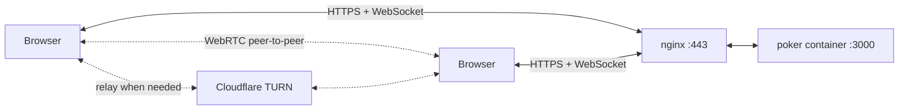

<div align="center">


# Poker

[](https://github.com/janfredrik/poker/actions/workflows/docker.yml)


[](LICENSE)

Self-hosted No-Limit Texas Hold'em for home games with friends, with a camera and microphone at every seat.

[Features](#features) • [Getting started](#getting-started) • [Rule sets](#rule-sets) • [Deployment](#deployment) • [Configuration](#configuration) • [Development](#development)

</div>

Open a table, share the link, and play. Friends pick a seat, type a name and a buy-in, and sit down: no accounts, no app to install. The server deals the cards, enforces the betting rules, runs the blind clock and settles every pot, while everyone sees and hears each other over peer-to-peer video. It runs as a single Docker container on your own hardware.

> [!NOTE]
> Play money only. The app can calculate how your group settles up at the end of the night (buy-ins, rebuys, who gets what), but it never moves or holds money.

## Features

- **Full NLH engine.** Dealer button, blinds, min-raises, short all-ins, side pots and split pots, all enforced by the server.
- **Tournaments and cash games.** Blind clock with breaks, rebuys, add-ons, shot clock with a refilling time bank, finishing places and payouts.
- **Video at the table.** Camera and microphone per seat over WebRTC, peer-to-peer first, with Cloudflare Realtime TURN as a relay for players behind strict NAT.
- **No accounts.** A seat is tied to a per-browser token. Scan a QR code to move your seat to your phone mid-game.
- **Ledger and settlement.** Buy-ins, rebuys, add-ons, cash-outs and net results per player.
- **Season standings.** Each finished tournament adds to calendar-year totals by player name, with records, knockouts, the season's best hand, and VPIP, PFR, AF, WTSD and W$SD per player.
- **Table extras.** All-in equity during runouts, rabbit hunt after a fold, emoji reactions thrown at other players' cameras, and a choice of walnut, slate or light oak around the felt.
- **Demo mode.** Visitors can try a game against bots with simulated cameras straight from the front page.
- **Survives restarts.** Tables, ledgers and rule sets are saved to disk. A hand interrupted by a restart is voided and the bets returned.
- **Optional AI dealer.** A voiced dealer who comments on big moments, welcomes players by name and answers when spoken to. See [DEALER.md](DEALER.md).

> [!TIP]
> The interface is in Norwegian Bokmål, with the established English poker terms (check, call, raise, all-in, …).

## Getting started

### Prerequisites

- [Node.js](https://nodejs.org/) 22 (20 or later works)
- [Docker](https://www.docker.com/) for deployment

### Run locally

```bash
git clone https://github.com/janfredrik/poker.git
cd poker
npm install
npm run dev
```

Open http://localhost:5173. The Vite client proxies `/api` and `/socket.io` to the server on port 3000. Camera and microphone work on `localhost` without HTTPS.

To try it alone, start a demo game from the front page, or seat bots at a table you opened:

```bash
npx tsx server/bots.ts <tableId> 4
```

## Rule sets

Five presets ship with the app: a standard tournament, a 10/20 cash game, a home tournament, a turbo and a freezeout. Pick one when you open a table, press **Edit rules** to change anything, and **Save as new rule set** to reuse it next time. Saved rule sets are stored in `DATA_DIR/rulesets.json`. The host can change the rules mid-game from the **Rules** tab; changes apply from the next hand.

| Setting | Meaning |
|---|---|
| Blinds go up every | Level length in minutes. `0` = fixed blinds (cash game). After the last level the blinds keep doubling. |
| Break after every / length | For example a 5-minute break every 4 levels. The current hand plays out first. |
| Rebuy amount | Chips per rebuy. `0` lets the player choose (cash game). |
| Rebuy period, through level | Rebuys close after this level. `0` = all game. |
| Max rebuys per player | `0` = unlimited. |
| Who can rebuy | Only when busted, at or below a stack size, or anyone between hands. |
| Add-on | One per player, available during the chosen level and the next. |
| Time to act | Shot clock in seconds. On timeout the player checks if possible, otherwise folds. `0` = off. |
| Rabbit hunt | Off by default. After a fold ends a hand before the river, anyone dealt in can reveal the remaining board. |

## Deployment

The app ships as one Docker image, built by GitHub Actions and pushed to GHCR on every push to `main`. It is designed to sit behind your own nginx reverse proxy.



1. Copy `docker-compose.yml` and `.env.example` to the server and create the env file:
   ```bash
   cp .env.example .env
   ```
   Set `POKER_IMAGE` (`ghcr.io/<github-user>/<repo>:latest`) and `DATA_PATH`, then fill in the Cloudflare values (see [Video relay](#video-relay)).
2. Pull and start:
   ```bash
   docker compose pull && docker compose up -d
   ```
3. Add the site from [deploy/nginx-poker.conf](deploy/nginx-poker.conf): set your hostname, certificate paths and the upstream in `proxy_pass`. It forwards the WebSocket upgrade the game needs.
4. Forward only `443/TCP` to nginx on your router. Do not expose port `3000`, and no TURN or media ports are needed.

> [!IMPORTANT]
> Browsers only allow camera and microphone over **HTTPS** (or on `localhost`).

The health check is `GET /api/health`, which also reports this month's TURN usage.

### Behind Cloudflare's proxy

The game works through Cloudflare's proxy (orange cloud): WebSockets are supported, and Socket.IO pings every 25 s, well inside Cloudflare's 100 s idle timeout. Use SSL mode **Full (strict)** with a Let's Encrypt or Cloudflare Origin certificate in nginx. No Cloudflare Tunnel is needed, and you can restrict port `443` to [Cloudflare's IP ranges](https://www.cloudflare.com/ips/).

### Video relay

Video and audio go **peer-to-peer** between browsers whenever possible. When two players can't reach each other directly (strict NAT, some mobile and corporate networks), the browser falls back to Cloudflare's TURN relay, including TURN over TLS on port 443, which gets through most firewalls. Media is end-to-end encrypted (DTLS-SRTP), so the relay can't see or hear it.

1. In the Cloudflare dashboard, go to **Realtime > TURN Server** and create a TURN key. Set `CF_TURN_KEY_ID` and `CF_TURN_API_TOKEN`. The token stays on the server; browsers get short-lived credentials (4 h, refreshed automatically), and only while they are at a real table with someone else there. Demo tables get STUN only.
2. For usage alerts, create an API token with **Account > Account Analytics > Read** and set `CF_ACCOUNT_ID` and `CF_ANALYTICS_TOKEN`.
3. Set `ALERT_WEBHOOK_URL` and restart the container. The log should say `[turn] watching TURN usage: ...`.

Without these values, or if the Cloudflare API is unreachable, the server falls back to STUN only: direct video keeps working, just without a relay.

> [!WARNING]
> Cloudflare includes 1 000 GB of Realtime traffic per month, then charges $0.05/GB. Only relayed connections count, but a 7-player table with all video relayed uses roughly 20 GB per hour. By default the server stops handing out TURN credentials at 100 % of the allowance (`TURN_STOP_AT_LIMIT=true`), so you are never billed.

<details>
<summary><strong>Usage alerts</strong></summary>

Every 15 minutes the server reads the account's TURN egress for the current billing period from Cloudflare's GraphQL Analytics API. It sends one alert per period at each `TURN_WARN_PERCENT` threshold (50, 80, 95 %) and at 100 %, and one if it can't read the usage at all. Alerts always go to the container log and are POSTed to `ALERT_WEBHOOK_URL`:

- **Home Assistant** (phone push via the companion app): an automation with a *Webhook* trigger (allow `POST`; untick "only accessible from local network" if Home Assistant isn't on the same network) and the action `notify.mobile_app_<phone>` with `title: "{{ trigger.json.title }}"` and `message: "{{ trigger.json.message }}"`. Use `http://<ha>:8123/api/webhook/<id>` as the URL.
- **Discord / Slack**: an incoming-webhook URL; `content` / `text` are in the JSON.
- **ntfy**: `https://ntfy.sh/<secret-topic>` with `ALERT_WEBHOOK_FORMAT=text`.

As a second line of defence, add a Cloudflare budget alert under **Manage Account > Billing > Billable Usage > Create budget alert** with a $1 threshold. It only fires once there is actual spend, so it catches the case where the app's own watch is broken. If your billing period doesn't start on the 1st, set `TURN_BILLING_DAY`.

</details>

<details>
<summary><strong>Testing the relay</strong></summary>

1. Open a table in two browsers. In devtools, the reply to `rtc:config` in the `/socket.io` WebSocket messages should list `stun:stun.cloudflare.com` and `turn:` / `turns:turn.cloudflare.com` URLs with a username and an `expiresAt`.
2. To test the relay alone, open [Trickle ICE](https://webrtc.github.io/samples/src/content/peerconnection/trickle-ice/), add `turns:turn.cloudflare.com:443?transport=tcp` with the username and credential from step 1, and gather. A candidate of type **relay** means TURN works.
3. Test across networks: one player on home Wi-Fi, one on mobile data, ideally one on a work or guest network. In Chrome, `chrome://webrtc-internals` shows whether each connection is `host`/`srflx` (direct) or `relay`.
4. To force the relay, run Chrome with `--force-webrtc-ip-handling-policy=disable_non_proxied_udp`, or block UDP on one test machine.
5. A few minutes later, **Realtime > TURN Server** in the dashboard and `GET /api/health` should show the traffic.

</details>

<details>
<summary><strong>Moving from coturn</strong></summary>

After the relay test succeeds, remove the old `coturn` container (`docker compose up -d --remove-orphans`), close router forwards `3478` UDP/TCP and `49160-49200` UDP, and delete the `TURN_HOST` DNS record. `TURN_HOST`, `PUBLIC_IP`, `TURN_SECRET` and `TURN_URLS` are no longer used.

</details>

## Configuration

All settings are environment variables. [.env.example](.env.example) has a commented template.

| Variable | Default | Description |
|---|---|---|
| `PORT` | `3000` | HTTP port inside the container. |
| `DATA_DIR` | `/data` | Tables, ledgers, rule sets, season results and TURN usage state. |
| `CREATE_CODE` | none | If set, opening a table and saving or deleting rule sets require this code. Joining by link and demo tables stay open. Each IP gets 10 table attempts and 15 demo tables per hour, with at most 3 demos live at once. |
| `TABLE_TTL_DAYS` | `14` | Idle tables are deleted after this. Tables where no hand was ever dealt are deleted after 24 h with nobody connected. |
| `CF_TURN_KEY_ID` | none | Cloudflare Realtime TURN key ID. Without it and the token: STUN only. |
| `CF_TURN_API_TOKEN` | none | The TURN key's API token (server only). |
| `TURN_TTL_HOURS` | `4` | Lifetime of the credentials browsers get (minimum 3); refreshed an hour before expiry. |
| `STUN_URLS` | Cloudflare STUN | Comma-separated, only used when TURN is not available. |
| `CF_ACCOUNT_ID` | none | Account ID for the usage watch. |
| `CF_ANALYTICS_TOKEN` | none | API token with Account Analytics Read. |
| `TURN_MONTHLY_GB` | `1000` | Free allowance the alerts are measured against. |
| `TURN_WARN_PERCENT` | `50,80,95` | Alert thresholds; 100 % always alerts. |
| `TURN_STOP_AT_LIMIT` | `true` | Stop handing out TURN credentials at 100 % until the next period. |
| `TURN_BILLING_DAY` | `1` | Day of month the billing period starts (1-28). |
| `ALERT_WEBHOOK_URL` | none | Where alerts are POSTed. |
| `ALERT_WEBHOOK_FORMAT` | `json` | `json` (`title`, `message`, `text`, `content`, `usedGB`, `limitGB`, `percent`) or `text` (ntfy). |

The Docker Compose file also reads `POKER_IMAGE`, `POKER_PORT`, `DATA_PATH`, `TZ`, `PUID` and `PGID` (Unraid: `99` / `100`).

<details>
<summary><strong>AI dealer variables</strong></summary>

The dealer only exists when an OpenRouter key and a voice (ElevenLabs or Azure Speech) are set up. The host then switches her on per table. Setup and removal are described in [DEALER.md](DEALER.md) (Norwegian).

| Variable | Default | Description |
|---|---|---|
| `OPENROUTER_API_KEY` | none | The dealer's brain. |
| `DEALER_MODEL` | `anthropic/claude-haiku-5.5` | OpenRouter model for her lines. |
| `DEALER_MAX_PER_HOUR` | `60` | Fresh lines and answers per table per hour. |
| `ELEVENLABS_API_KEY` | none | Her voice. |
| `ELEVENLABS_VOICE_ID` | none | A Norwegian female voice from your ElevenLabs voice library. |
| `ELEVENLABS_MODEL_LIVE` | `eleven_v4_turbo` | Voice model for fresh lines. |
| `ELEVENLABS_MODEL_FIXED` | `eleven_v4` | Voice model for fixed lines (made once, kept in `DATA_DIR/dealer/`). |
| `AZURE_SPEECH_KEY` | none | Speech-to-text so players can talk to her (push-to-talk), and optionally her voice. |
| `AZURE_SPEECH_REGION` | none | Azure Speech region, for example `norwayeast`. |
| `DEALER_VOICE` | ElevenLabs if set up, else Azure | `elevenlabs` or `azure`. |
| `AZURE_TTS_VOICE` | `nb-NO-PernilleNeural` | Azure voice (`nb-NO-IselinNeural` is the other Norwegian female voice). |

</details>

## Development

| Command | Description |
|---|---|
| `npm run dev` | Server with hot reload on :3000 and Vite client on :5173. |
| `npm test` | Engine self-test (hand evaluator, scenarios and hundreds of random games checking chip conservation), then the client component tests (Vitest). |
| `npm run test:e2e` | Builds and plays a few hands against a demo bot in a real browser (Playwright). |
| `npm run typecheck` | Type-checks the client and the server. |
| `npm run build` | Builds the client to `dist/client` and bundles the server to `dist/server.js`. |
| `npm start` | Runs the production build. |

> [!TIP]
> Before the first `npm run test:e2e`, run `npx playwright install chromium`, or set `PW_CHANNEL=chrome` to use your installed Chrome.

### Project structure

```
server/   Node + Express + Socket.IO. The authoritative game engine (table.ts), persistence, TURN, bots
client/   React 18 + Vite single-page app
shared/   Wire types and rule-set presets used by both sides
e2e/      Playwright smoke test
deploy/   nginx site config
```

The server owns all game logic; the client only renders a per-player view and sends intents, so nobody can see cards they shouldn't. For more depth, see [CLAUDE.md](CLAUDE.md) (architecture), [PRODUCT.md](PRODUCT.md) (product intent) and [DESIGN.md](DESIGN.md) (visual system).
